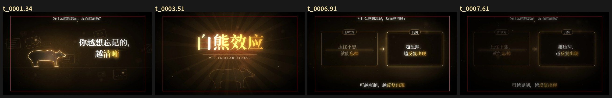

# zhishi-video · 知识大赏视频生成器

**全部用代码画出来的知识科普短视频。** 你给出主题、故事角度、时长、背景音乐和横竖屏，它会帮你生成：

- 卡在音乐小节上的分镜和字幕时间轴
- 黑金风格的逐帧动画（Canvas 2D 绘制，Playwright 截帧）
- 混好的音轨：BGM 加合成音效，−14 LUFS
- H.264 成片（mp4）和 SRT 字幕
- 3:4、4:3 封面，竖屏另加 9:16
- 一份自动 QA 报告

样式是插件式的。默认样式是 `zhishi-dashang`（黑金知识大赏）；想加新画风，复制 `styles/_template/` 改成自己的就行，管线代码一行不用动。

本仓库同时是一个 **Agent Skill**：`SKILL.md` 带标准 frontmatter，放进支持 skills 的 agent（如 Claude Code 等）后，说一句「做个知识大赏视频」就会按流程执行。




## 只需要 5 个输入

| 输入 | 说明 | 默认 |
|---|---|---|
| 主题 | 一个大众知道的概念，例如效应、定律、偏差 | 必填 |
| 故事角度 | 「你以为… → 其实… → 怎么用」从哪个生活场景切入 | 必填 |
| 视频时长 | 目标时长，不是硬上限，长度以文案为准 | 60 s |
| 背景音乐 | 你有版权的音乐文件；不提供就只用合成音效 | 无 |
| 横屏 / 竖屏 | `landscape` 1920×1080、`portrait` 1080×1920，或 `both` | 横屏 |

## 快速开始

```bash
git clone https://github.com/jingtiantx/zhishi-video && cd zhishi-video
npm install                                  # playwright-core，并下载 Chromium
python3 -m venv .venv && .venv/bin/pip install -r requirements.txt
sh scripts/check_env.sh                      # 检查 node / ffmpeg / python 依赖 / chromium / 字体

# 1) 跑示例：约 9 秒的白熊效应，横竖屏各一版
#    （可选）把你的 BGM 放到 examples/white-bear-demo/audio/bgm.mp3
python3 scripts/zv.py build examples/white-bear-demo -o both --workers 4

# 2) 做自己的一期
python3 scripts/zv.py new my-film --topic 白熊效应 --angle "越想忘记越清晰" --duration 60 --bgm audio/bgm.mp3 --orientation portrait
#    依次填 my-film/SOURCES.md → script.txt → project.json 的 scenes
python3 scripts/zv.py timeline my-film       # 看节奏（每行字/秒）和自动分镜表
python3 scripts/zv.py stills my-film         # 每镜一帧的预览拼图
python3 scripts/zv.py build my-film --out deliver/
```

产物都在 `--out` 目录（默认 `<项目>/out/`）：`<slug>_<方向>.mp4`、`.srt`、`_cover_3x4/4x3/9x16.png`、`STORYBOARD.md`，以及 `qa_<方向>/report.json` 和 `qa_<方向>/contact.jpg`。

## 环境要求

- **Node.js ≥ 18**，加 `playwright-core`（`npm install` 会顺带下载 Chromium）。也可以用 `ZV_CHROMIUM=/path/to/chrome` 指定本机的 Chrome。
- **Python ≥ 3.9**，装好 `requirements.txt`：numpy、scipy、librosa、pyloudnorm、soundfile、Pillow、fonttools。可用 `ZV_PY` 指定解释器。
- **FFmpeg / ffprobe**：需要带 libx264，并且在 PATH 里。
- **字体**：Noto Serif CJK SC 或 Noto Serif SC，Bold + Regular，[OFL 协议](https://github.com/notofonts/noto-cjk)。仓库不附带字体文件：
  - 脚本会自动在系统字体目录和 `fonts/` 里找。
  - 也可以用 `ZV_FONT_BOLD` / `ZV_FONT_REGULAR` 指定路径。
  - Ubuntu/Debian 可直接 `apt install fonts-noto-cjk`。
- 渲染速度大约 0.7 帧/秒/worker：60 秒视频共 1800 帧，8 核机器开 6 个 worker 约 7 分钟。
- 整条管线不联网，也不需要任何账号或密钥。

## 样式系统

```
styles/
  zhishi-dashang/   默认：暖黑底、金色线稿、思源宋体、关键词金色、辉光 + 颗粒、踩拍切镜
    style.md        规范：色板 / 字体 / 横竖屏版式网格 / 动效规则 / 16 种场景 / 封面规范
    style.json      时间参数、音效映射、字体候选、封面尺寸
    engine.js       底层：背景、文字（/ 换行、[词] 标金）、字幕、钩子、转场、后期
    scenes.js       场景库：hook、title、compare、steps、stat、dawn 等，以及 14 个线稿 motif
    cover.js        封面：徽章、立体金字标题、英文、问句、motif 地平线、出处
  _template/        新样式骨架：可直接运行的最小实现，附 CHECKLIST.md
```

**选样式**：在 `project.json` 里写 `"style": "<id>"`；`python3 scripts/zv.py styles` 可以列出全部已装样式。

**加样式**：

1. `cp -r styles/_template styles/my-style`，把 `style.json` 里的 `name` 改成 `my-style`。
2. 按 `styles/_template/CHECKLIST.md` 实现渲染契约：
   - `window.ready` 和 `window.draw(t)`：每一帧只由 t 决定，随机数一律用固定种子。
   - `window.drawCover(kind)`。
   - `ZD.scene` / `ZD.motif` 扩展点。
   - 横竖屏两套版式。
3. 用 `examples/scene-gallery` 预览所有场景：`zv.py stills … -o both`，再跑一次短片 `build`，确认 QA 通过。
4. 在 `styles/README.md` 登记。

**每期专属画面**（比如白熊、巴甫洛夫的狗）：写在项目目录的 `motifs.js` 里，用 `ZD.motif(name, fn, {h})` 注册，参考 `examples/white-bear-demo/motifs.js`。

## 项目配置要点（project.json）

- `scenes[]`：一镜一个对象，`{"scene": "compare", "left": {...}, "right": {...}, "lines": [...]}`。
  - 每句字幕可以是字符串，也可以写成 `{text, style: band|big|center|none, hold, stamp}`。
- `hook`：顶部常驻问句。`title`：片名。`cover`：封面文字和 motif。
- `bgm`：`{path, offset, fit: trim|loop, optional}`。`snap`：`bar`、`beat` 或 `none`。
- `forbidden_text`：绝不能出现的字符串，比如品牌名或别人的账号名。构建时会直接中止，QA 会扫描所有产物。
- `front_blocklist`：不希望出现在标题、钩子、封面、首句里的词，QA 会给出警告。

## 可选：文案去 AI 味

`zv.py lint <项目>` 会调用外部 linter，比如 [taishang-laojun](https://github.com/liuhaisi2026212-maker/taishang-laojun) 里的 `scripts/ai_tell_linter.py`。用 `ZV_LINTER=/path/to/ai_tell_linter.py` 指定位置。本仓库不附带它的代码。

---

## English

**zhishi-video** renders Chinese explainer videos ("知识大赏") entirely in code. A Canvas 2D page draws each frame as a pure function of `t`, Playwright captures the frames, and ffmpeg muxes them with a mix that is beat-analysed (librosa) and loudness-normalised (−14 LUFS).

You provide five things: topic, story angle, target duration, background music and orientation. You get back an mp4, an SRT, 3:4 / 4:3 / 9:16 covers, a storyboard and a QA report covering resolution, duration, audio stream, loudness, forbidden text, reading speed and a contact sheet.

Looks are pluggable **styles**. Copy `styles/_template/`, implement the small render contract in its `CHECKLIST.md`, and select it with `"style"` in `project.json`.

The repo also works as an agent skill: `SKILL.md` has standard frontmatter.

- **Requirements:** Node ≥ 18 with `npm install` (playwright-core + Chromium), Python ≥ 3.9 with `pip install -r requirements.txt`, ffmpeg with libx264, and Noto Serif CJK SC fonts (OFL; not bundled).
- **Quick start:** `python3 scripts/zv.py build examples/white-bear-demo -o landscape`.
- **No network calls, no credentials.**

## Credits

- Inspired by the code-film approach of [lemo-opuscar](https://github.com/lemomo-ai/lemo-opuscar) (MIT, LemoLab) and [xilo-opus-video](https://github.com/Kianzzz/xilo-opus-video) (MIT, Kianzzz). No code from either is included.
- Optional script linter: [taishang-laojun](https://github.com/liuhaisi2026212-maker/taishang-laojun). Not bundled.
- Fonts: [Noto Serif CJK](https://github.com/notofonts/noto-cjk) (SIL OFL 1.1). Not bundled.
- See [THIRD-PARTY-NOTICES.md](THIRD-PARTY-NOTICES.md).

## License

[MIT](LICENSE) © 2026 jingtiantx
